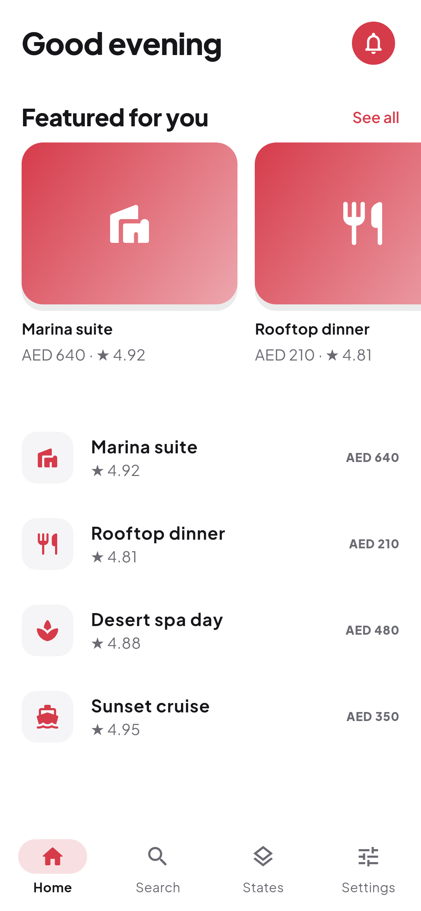
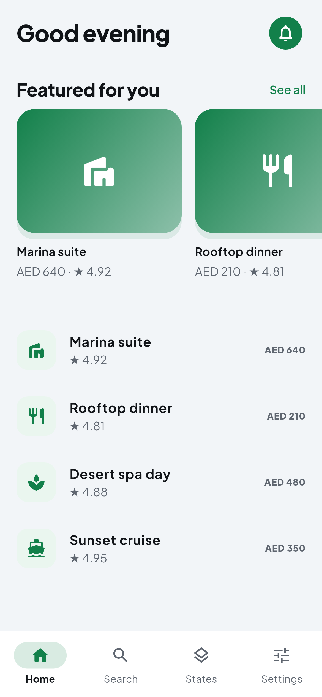
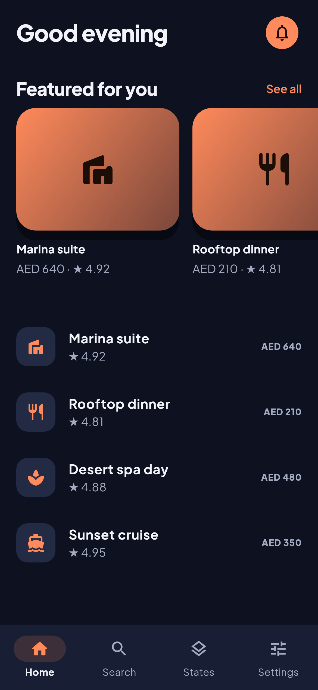
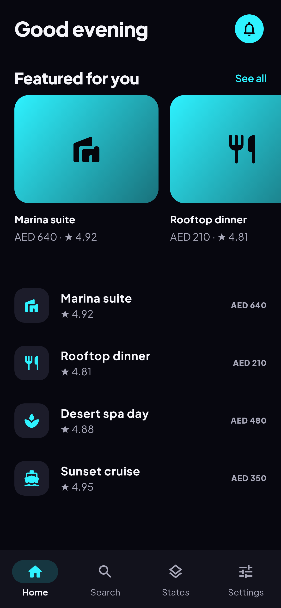
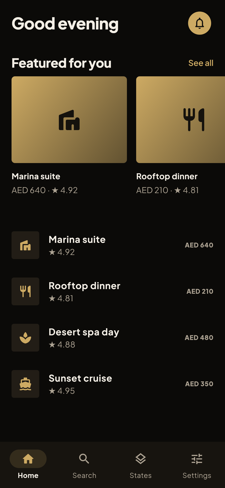
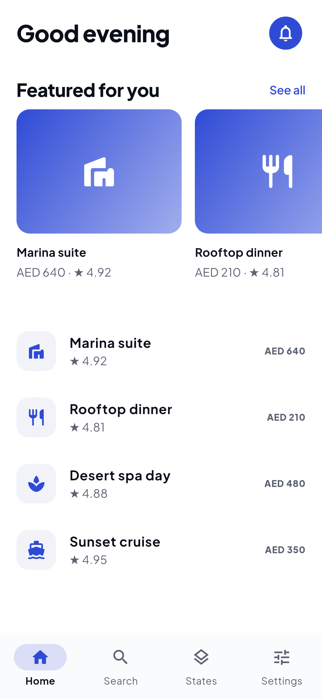
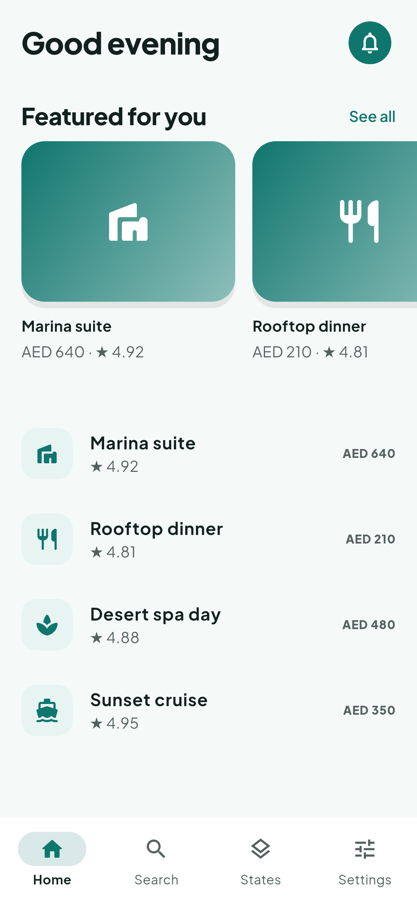
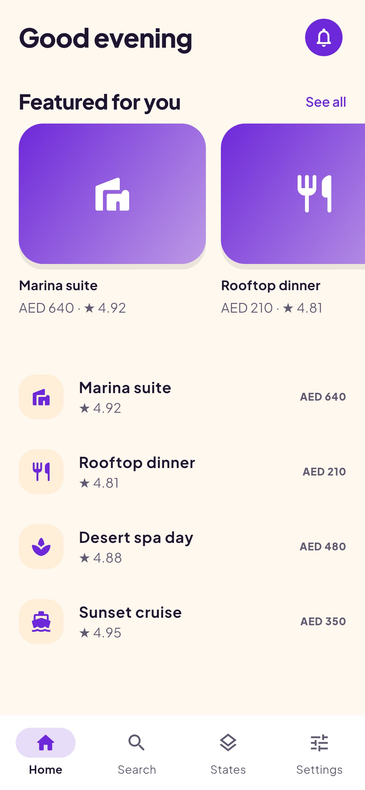

# کاتالوگ سبک‌های اپ

> **نوع سند:** مرجع
> **هدف این سند:** برای هر اپ تازه، Claude از روی موضوع و حس خواسته‌شده یک سبک نام‌دار با دستور دقیق (رنگ، فونت، گوشه، سایه، حرکت، امضای دیداری) پیشنهاد دهد و همان را با توکن‌های قالب شروع بسازد؛ سلیقه‌ی ثبت‌شده‌ی کاربر هم این‌جاست.
> **موضوع تحقیق:** سبک‌های رایج اپ، نمونه‌هایی که کاربر دوست داشته (دسته‌ی ۱۴، دسته‌ی ۱۷)، و پیاده‌سازی آزموده در قالب شروع.
> **منابع:** [S133 سیستم طراحی اپ](../../sources/README.md#s133) · [S121 Code and Chill](../../sources/README.md#s121) · [S132 design-lab](../../sources/README.md#s132)
> **آخرین بررسی:** ۲۰۲۶-۱۰-۲۱
> **دفعه‌ی بعد چک شود:** هر سبک تازه که کاربر پسندید اضافه شود؛ فونت سریف برای «لوکس» (مثلاً Cormorant Garamond، OFL) هنوز در قالب نیست.

---

## سلیقه‌ی ثبت‌شده‌ی کاربر ⭐
کاربر صریحاً گفته این‌ها را «خیلی دوست دارد». وقتی سبکی نخواست، از این‌ها شروع کن:
- داشبورد انبار Code & Chill ← **Fresh dashboard**؛ داشبورد شیشه‌ای Tavola ← **Night glass** ([کارت](../../catalog/code-and-chill.md)).
- لوگوی نئون DailyFlutterUI ← **Neon night**؛ اپ اجاره‌ی تمیز ← **Clean marketplace**؛ ردیابی زنده ← الگوی «نقشه و ردیابی» در [کاتالوگ صفحه‌ها](app-screen-patterns.md) ([design-lab](app-design.md#الگوهای-آزموده-در-flutter-design-lab-۲۰۲۶-۱۰-۲۱-)).
- سایت عطر لوکس سیاه‌طلایی ← **Luxury noir**.

⛔ از هیچ‌کدام کد، لوگو یا متن کپی نمی‌شود؛ فقط اصول.

## نمای همه‌ی سبک‌ها
عکس‌های مرجع آزمون golden قالب شروع (صفحه‌ی خانه، ۳۹۰×۸۴۴):

| | | | |
|---|---|---|---|
|  |  |  |  |
| Clean marketplace | Fresh dashboard | Night glass | Neon night |
|  |  |  |  |
| Luxury noir | Minimal fintech | Calm care | Playful |

✅ همه‌ی رنگ‌های پایین از آزمون کنتراست قالب (`test/tokens_test.dart`، WCAG) سبز گذشته‌اند. 🧭 «برای» و «حس» هر سبک پیشنهاد ماست، نه قانون. هر سبک در کد: `AppStyle.<نام>` در `lib/design/styles.dart`.

## سبک‌ها

### Clean marketplace (`cleanMarket`) — روشن و تیره
- **برای:** رزرو، اجاره، فروشگاه، فهرست آگهی، رستوران.
- **حس:** تمیز، قابل اعتماد، عکس‌محور.
- **رنگ:** زمینه سفید؛ متن `#16161A`؛ تأکید مرجانی `#D63B4A` (روی آن سفید)؛ در تیره `#FF6B75`.
- **شکل:** کارت عکس بزرگ با گوشه‌ی ۲۰، نشان سفید روی عکس، سایه‌ی نرم ۱۸.
- **حرکت:** ورود پلکانی کارت‌ها، اسکلت پیش از داده، پرش کوچک دکمه‌ی پسند.
- **امضا:** نوار جستجوی گرد شناور، تب‌های دسته با آیکون و زیرخط.

### Fresh dashboard (`freshGreen`) — روشن و تیره
- **برای:** انبار، فروش، پنل مدیریت روی موبایل، گزارش.
- **رنگ:** زمینه `#F2F5F8`، کارت سفید با حاشیه‌ی سبز کم‌رنگ؛ تأکید `#12804A`؛ هاله‌ی سبز `#34D27B` پشت عدد و کارت.
- **شکل:** گوشه‌ی ۲۲، سایه‌ی سبزرنگ؛ عقربه‌ی نیم‌دایره‌ی تیک‌دار، عکس محصول بی‌پس‌زمینه.
- **تیتر:** خیلی ضخیم و فشرده.

### Night glass (`glassDash`) — فقط تیره
- **برای:** داشبورد تحلیلی، کنترل دستگاه، اپی که مدت طولانی روی صفحه است.
- **رنگ:** سرمه‌ای `#0D1120`، کارت `#181E33`، تأکید مرجانی‌نارنجی `#FF8A5B`.
- **امضا:** شیشه‌ی مات (`BackdropFilter` با blur حدود ۲۶)، چند لکه‌ی نور محو پشت کارت‌ها؛ دستور کامل در [سبک‌های طراحی وب، شیشه‌ای](../website/02-design/design-styles.md).
- ⚠️ blur گران است؛ روی فهرست بلند استفاده نکن.

### Neon night (`neonNight`) — فقط تیره
- **برای:** بازی، رویداد شبانه، موسیقی، معرفی محصول پرهیجان.
- **رنگ:** تقریباً سیاه `#07070F`، تأکید فیروزه‌ای `#2EF2FF`، هاله‌ی صورتی `#FF3DCB`.
- **امضا:** کشیدن خط نئون با سر روشن، لرزش رنگ (glitch) صورتی و فیروزه‌ای، گذار مورب؛ کد در design-lab (`lib/widgets/neon_logo.dart`).
- ⚠️ لرزش و چشمک را با «کاهش حرکت» خاموش کن.

### Luxury noir (`luxuryGold`) — فقط تیره
- **برای:** عطر، جواهر، هتل، خدمات ویژه.
- **رنگ:** سیاه گرم `#0B0A08`، متن کرم `#F4EFE6`، طلایی `#CDAA63`.
- **شکل:** گوشه‌ی تیز (۲ تا ۶)، بی‌سایه؛ خط باریک طلایی جای سایه.
- **تیتر:** سریف باریک با فاصله‌ی حروف زیاد (هنوز در قالب نیست؛ اضافه کن). عکس سینمایی محصول تمام‌عرض.

### Minimal fintech (`fintechMinimal`) — روشن و تیره
- **برای:** بانک، کیف پول، ابزار شرکتی.
- **رنگ:** سفید، متن `#0B0F19`، آبی سرد `#2F4BD6`.
- **قانون:** عدد اول، حرکت خیلی کم، بی‌سایه، گوشه‌ی ۱۶؛ رنگ سبز و قرمز فقط برای سود و زیان.

### Calm care (`calmHealth`) — روشن و تیره
- **برای:** سلامت، کلینیک، آرامش، **خدمات دولتی**.
- **رنگ:** زمینه‌ی نعنایی `#F5FAF9`، تأکید سبزآبی `#0F766E`.
- **قانون:** فاصله‌ی سخاوتمند، گوشه‌ی ۲۲ تا ۳۲، بدون رنگ و متن اضطراری مگر واقعاً لازم؛ متن ساده.

### Playful (`playful`) — روشن و تیره
- **برای:** کودک، آموزش، شبکه‌ی اجتماعی، عادت‌سازی.
- **رنگ:** کرم گرم `#FFF8EF`، بنفش `#6D28D9`.
- **شکل:** گوشه‌ی خیلی گرد (۱۸ تا ۳۶)، حرکت فنری.

## افزودن سبک تازه
1. در `lib/design/styles.dart` یک مقدار تازه‌ی `AppStyle` با نام، «برای چه» و توکن‌ها.
2. `flutter test` (آزمون کنتراست باید سبز شود)، بعد `flutter test --tags golden --update-goldens` برای عکس.
3. یک بخش در همین سند، با منبع الهام (فقط اصول) و عکس golden.

## مرتبط
[سیستم طراحی اپ](app-design-system.md) · [کاتالوگ صفحه‌ها](app-screen-patterns.md) · [سبک‌های طراحی وب](../website/02-design/design-styles.md) · [S133](../../sources/README.md#s133)
